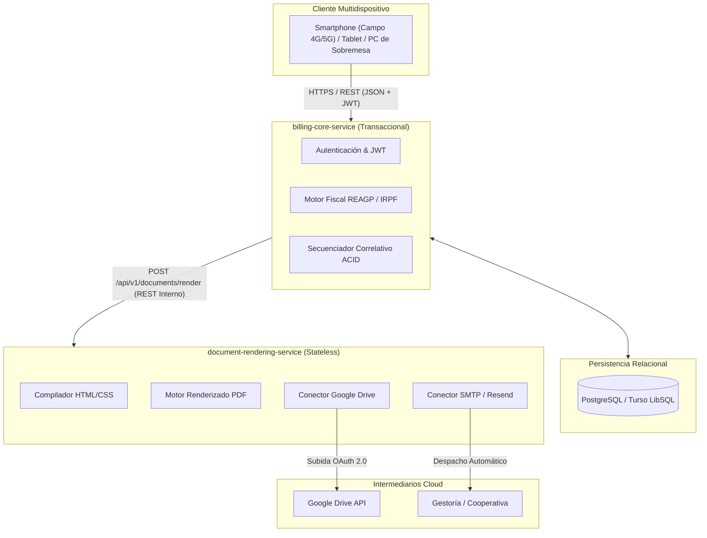

# AgroFactura Cloud 🌾📄

[](docs/README.md)
[](LICENSE)
[](docs/README.md#4-arquitectura-de-referencia-y-microservicios)
[](docs/README.md#2-justificación-teórica-bajo-nist-sp-800-145)

> **Sistema Cloud-Native de Facturación y Cumplimiento Tributario para Pequeñas Explotaciones Agrícolas**  
> Proyecto desarrollado para la asignatura *Cloud Computing: Fundamentos e Infraestructuras*  
> **Máster Universitario en Ingeniería Informática** — Universidad de Granada  
> **Autor:** Germán Álvarez Gavilán ([@gag-04](https://github.com/gag-04))

---

## 📖 Descripción del Proyecto y Problemática de Negocio

**AgroFactura Cloud** nace de una necesidad real observada directamente en una explotación agraria familiar (olivar y cultivos tradicionales): actualmente, la emisión de facturas y liquidaciones de cosecha tras la entrega en almazaras y cooperativas se realiza **manualmente mediante plantillas de Excel** guardadas en un ordenador de escritorio local.

### El Problema de las Hojas de Cálculo Tradicionales
- ⚠️ **Riesgo crítico de pérdida de información:** Almacenamiento local en disco sin respaldos automatizados en la nube.
- 📱 **Falta de ubicuidad y movilidad:** El agricultor no puede consultar ni facturar a pie de campo, desde el tractor o en la báscula de pesaje; debe desplazarse a su hogar.
- 🧮 **Errores de cálculo impositivo:** La fiscalidad agrícola en España (**Régimen Especial de Agricultura, Ganadería y Pesca - REAGP**) no aplica el 21% de IVA, sino una **compensación a tanto alzado del 12%** (agrícola/forestal) o **10.5%** (ganadero) y una **retención fija de IRPF del 2%**. Las fórmulas manuales en Excel suelen alterarse y generar descuadres en declaraciones tributarias (Modelos 130/131 y 303/390).
- ⚖️ **Ruptura de correlatividad legal (Riesgo sancionador AEAT):** El RD 1619/2012 y el nuevo marco antifraude (**Ley 11/2021 y reglamento VeriFactu**) exigen numeración consecutiva estricta sin huecos ni saltos temporales. El Excel permite sobrescrituras accidentales con severas sanciones tributarias.

### La Solución Cloud-Native
AgroFactura Cloud proporciona un ecosistema desacoplado que automatiza la correlatividad estricta, aplica el motor de reglas fiscales agrícolas, genera documentos PDF de alta fidelidad, sincroniza automáticamente el archivo documental en **Google Drive** y despacha notificaciones por correo a la gestoría y clientes.

---

## 🏛️ Arquitectura de Referencia

La arquitectura se diseña desacoplada siguiendo el **Principio de Responsabilidad Única (SRP)** en dos microservicios autónomos más una capa de persistencia transaccional:

1. **`billing-core-service` (Backend Transaccional y Fiscal):**  
   Autenticación, gestión de clientes/artículos, correlatividad atómica y motor de reglas fiscales agrarias (REAGP al 12%/10.5% e IRPF al 2%).
2. **`document-rendering-service` (Servicio Stateless de Generación y Despacho):**  
   Recibe JSON precalculado, compila plantillas HTML/CSS, renderiza el PDF binario de alta fidelidad, lo sube de forma desatendida a **Google Drive** (vía OAuth 2.0) y despacha correos vía pasarela transaccional (SMTP/Resend).
3. **Capa de Persistencia:**  
   Base de datos relacional (**PostgreSQL / Turso LibSQL**) para garantizar transacciones ACID y secuencias inmutables.



---

## 📐 Justificación Teórica y Estándares NIST

- **NIST SP 800-145 (5 Características Esenciales):**  
  Autoservicio bajo demanda (emisión 24/7 sin intermediarios), Acceso amplio a la red (móvil/web vía REST), Asignación común de recursos (multitenancy seguro), Rápida elasticidad (absorción de picos de cosecha y **scale-to-zero** en meses de inactividad) y Servicio medido (facturación granular por CPU/MB).
- **NIST SP 500-292 e Impacto Económico:**  
  Mapeo de roles (*Consumer, Provider, Broker, Auditor, Carrier*). Transición de **CapEx** (compra de servidores/licencias locales) a **OpEx** (pago por uso), aprovechando los *Free Tiers* de Google Cloud Run, Turso y Google Drive para un **coste operativo marginal de ~0 €/mes**.

---

## 📚 Estructura y Documentación de Hitos

La documentación exhaustiva del proyecto se encuentra en la carpeta [`docs/`](docs/):

* 📘 **[Memoria Técnica de Hito 1 (`docs/README.md`)](docs/README.md):**
  - Análisis detallado del dominio agrícola y problemática fiscal.
  - Justificación completa bajo NIST SP 800-145 y NIST SP 500-292.
  - Estudio económico comparativo CapEx vs OpEx.
  - Justificación académica del desacoplamiento de microservicios y diagramas de secuencia.
  - Especificación sintética completa de la API REST (rutas, payloads JSON y códigos HTTP).
  - Catálogo de 6 Historias de Usuario (US-01 a US-06) con criterios Gherkin y tareas técnicas.
  - Guías de gestión de ingeniería de software en GitHub.

---

## 🛠️ Organización del Repositorio

```
.
├── .github/
│   ├── ISSUE_TEMPLATE/
│   │   └── user_story.md       # Plantilla estandarizada para Historias de Usuario
│   └── PULL_REQUEST_TEMPLATE.md# Plantilla formal para Pull Requests
├── docs/
│   ├── README.md               # Memoria técnica completa del Hito 1
│   └── hito1.md                # Índice de acceso al Hito 1
├── .gitignore                  # Reglas de exclusión para Cloud-Native
├── LICENSE                     # Licencia del proyecto
└── README.md                   # Presentación del proyecto
```

---

## 🌿 Metodología de Desarrollo

- **Estrategia de Ramas:** Basada en **GitHub Flow** (`main` para código estable, ramas de trabajo `feature/*`, `fix/*`, `docs/*`).
- **Commits Semánticos:** Conforme a [Conventional Commits v1.0.0](https://www.conventionalcommits.org/) (`feat:`, `fix:`, `docs:`, `refactor:`, `test:`, `ci:`).
- **Gestión Ágil:** Tablero en **GitHub Projects** con seguimiento por *Milestones* y trazabilidad mediante *Issues* etiquetados como `user-story`.

---

## 📄 Licencia

Este proyecto se distribuye bajo la licencia **MIT**. Consulte el archivo [LICENSE](LICENSE) para más detalles.
