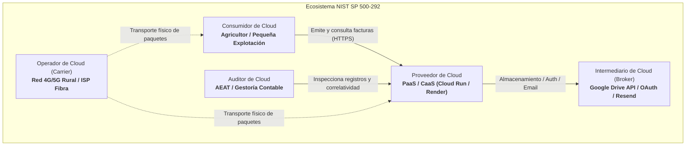
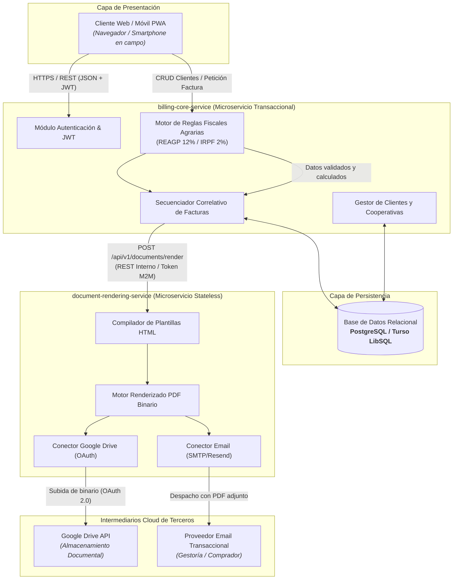
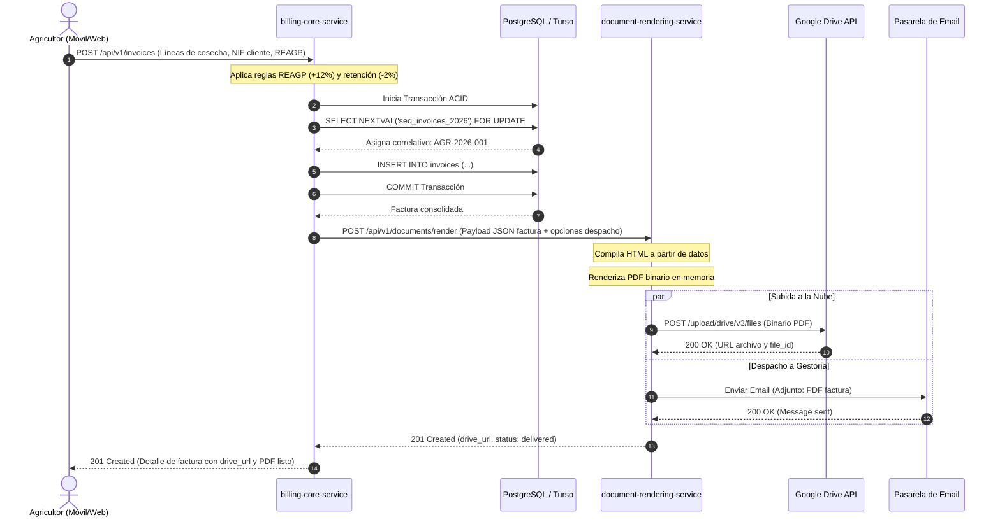

# AgroFactura Cloud: Sistema Cloud-Native de Facturación Agrícola

> **Hito 1: Definición del Proyecto, Modelo de Negocio y Arquitectura de Referencia**  
> **Asignatura:** Cloud Computing: Fundamentos e Infraestructuras  
> **Máster Universitario en Ingeniería Informática** — Universidad de Granada  

---

## Tabla de Contenidos

1. [Definición del Dominio y Problemática de Negocio](#1-definición-del-dominio-y-problemática-de-negocio)
   - [1.1. Contexto y Caso de Uso Real](#11-contexto-y-caso-de-uso-real)
   - [1.2. Problemática del Modelo Tradicional Basado en Hojas de Cálculo](#12-problemática-del-modelo-tradicional-basado-en-hojas-de-cálculo)
   - [1.3. La Complejidad Fiscal Agraria en España (REAGP e IRPF)](#13-la-complejidad-fiscal-agraria-en-españa-reagp-e-irpf)
   - [1.4. Propuesta de Solución: AgroFactura Cloud](#14-propuesta-de-solución-agrofactura-cloud)
2. [Justificación Teórica bajo NIST SP 800-145](#2-justificación-teórica-bajo-nist-sp-800-145)
   - [2.1. Las 5 Características Esenciales de la Nube](#21-las-5-características-esenciales-de-la-nube)
3. [Mapeo de Actores bajo NIST SP 500-292 e Impacto Económico](#3-mapeo-de-actores-bajo-nist-sp-500-292-e-impacto-económico)
   - [3.1. Roles de la Arquitectura de Referencia Cloud](#31-roles-de-la-arquitectura-de-referencia-cloud)
   - [3.2. Análisis de Impacto Económico: De CapEx a OpEx](#32-análisis-de-impacto-económico-de-capex-a-opex)
4. [Arquitectura de Referencia y Microservicios](#4-arquitectura-de-referencia-y-microservicios)
   - [4.1. Desacoplamiento y Principio de Responsabilidad Única (SRP)](#41-desacoplamiento-y-principio-de-responsabilidad-única-srp)
   - [4.2. Definición de Componentes y Microservicios](#42-definición-de-componentes-y-microservicios)
   - [4.3. Diagrama Conceptual de Arquitectura (Mermaid)](#43-diagrama-conceptual-de-arquitectura-mermaid)
   - [4.4. Diagrama de Secuencia: Ciclo de Emisión de Factura](#44-diagrama-de-secuencia-ciclo-de-emisión-de-factura)
5. [Especificación Sintética de la API REST](#5-especificación-sintética-de-la-api-rest)
   - [5.1. Endpoints de `billing-core-service`](#51-endpoints-de-billing-core-service)
   - [5.2. Endpoints de `document-rendering-service`](#52-endpoints-de-document-rendering-service)
6. [Catálogo de Historias de Usuario (Backlog Inicial)](#6-catálogo-de-historias-de-usuario-backlog-inicial)
   - [US-01: Autenticación federada de la explotación agraria](#us-01-autenticación-federada-de-la-explotación-agraria)
   - [US-02: Gestión de directorio de cooperativas y clientes](#us-02-gestión-de-directorio-de-cooperativas-y-clientes)
   - [US-03: Emisión y cálculo automatizado de factura bajo REAGP](#us-03-emisión-y-cálculo-automatizado-de-factura-bajo-reagp)
   - [US-04: Renderizado de PDF oficial y subida desatendida a Google Drive](#us-04-renderizado-de-pdf-oficial-y-subida-desatendida-a-google-drive)
   - [US-05: Despacho automatizado por email a gestoría contable](#us-05-despacho-automatizado-por-email-a-gestoría-contable)
   - [US-06: Verificación de correlatividad y trazabilidad antifraude](#us-06-verificación-de-correlatividad-y-trazabilidad-antifraude)
7. [Configuración de Ingeniería de Software en GitHub](#7-configuración-de-ingeniería-de-software-en-github)
   - [7.1. Estrategia de Ramas (GitHub Flow)](#71-estrategia-de-ramas-github-flow)
   - [7.2. Convención de Commits Semánticos](#72-convención-de-commits-semánticos)
   - [7.3. Gestión del Proyecto con GitHub Projects y Milestones](#73-gestión-del-proyecto-con-github-projects-y-milestones)

---

## 1. Definición del Dominio y Problemática de Negocio

### 1.1. Contexto y Caso de Uso Real
En el sector primario español, miles de pequeños agricultores familiares y autónomos agrarios gestionan directamente sus explotaciones agrícolas (cultivos de olivar, almendros, viñedo, cereales o frutales). 

El punto de partida de este proyecto se basa en un caso real directo: un pequeño agricultor familiar que, tras recolectar y entregar sus cosechas (por ejemplo, aceituna para almazara o cereal en cooperativas), debe emitir las correspondientes facturas comerciales a los compradores o albaranes liquidados para presentar periódicamente ante su gestoría administrativa.

### 1.2. Problemática del Modelo Tradicional Basado en Hojas de Cálculo
Actualmente, el proceso se efectúa de forma manual mediante una plantilla de hoja de cálculo (Excel) almacenada localmente en el ordenador de casa del agricultor:

- **Riesgo crítico de pérdida de datos:** Las hojas de cálculo se almacenan en discos duros locales sin mecanismos automáticos de copia de seguridad redundante. Una avería física o infección de malware conlleva la pérdida irrecuperable de años de histórico tributario.
- **Incompatibilidad y falta de ubicuidad:** El agricultor no puede consultar ni emitir una factura desde el tractor, la cooperativa o la báscula de pesaje mediante su teléfono móvil. Requiere desplazarse físicamente a su domicilio para abrir el archivo en el ordenador.
- **Vulnerabilidad a errores humanos en fórmulas:** La edición manual de celdas provoca frecuentemente la sobreescritura accidental de fórmulas de suma, bases imponibles o tipos impositivos.
- **Ruptura de la correlatividad de numeración (Riesgo sancionador AEAT):** El Real Decreto 1619/2012 y la reciente normativa tributaria contra el fraude fiscal (Ley 11/2021 y sistema VeriFactu) exigen una estricta numeración correlativa y cronológica sin huecos ni saltos temporales. En un archivo Excel es trivial alterar o duplicar números de factura inadvertidamente, lo que expone al agricultor a inspecciones y severas sanciones tributarias.
- **Proceso artesanal y fragmentado de distribución:** Tras rellenar el Excel, el agricultor debe exportar manualmente a PDF, abrir el cliente de correo o WhatsApp, adjuntar el archivo y enviárselo a la gestoría y a la cooperativa compradora.

### 1.3. La Complejidad Fiscal Agraria en España (REAGP e IRPF)
El sector agrario en España no tributa bajo el régimen general del IVA, sino mayoritariamente bajo el **Régimen Especial de la Agricultura, Ganadería y Pesca (REAGP)**:

1. **Compensación a tanto alzado en lugar de IVA ordinario:**
   - Para productos agrícolas y forestales: **12.0%** de compensación a tanto alzado.
   - Para productos ganaderos y pesqueros: **10.5%** de compensación a tanto alzado.
   - A diferencia del IVA estándar, esta compensación la cobra el agricultor del comprador para compensar el IVA soportado en sus insumos (gasóleo agrícola, fertilizantes, fitosanitarios), sin liquidación periódica deducible estándar en el modelo 303.
2. **Retención de IRPF agrario:**
   - Con carácter general, las entregas de productos agrícolas están sujetas a una retención fija del **2.0%** de IRPF (o del **1.0%** para actividades ganaderas de engorde y avicultura).
3. **Cálculo del Total de Factura:**
   $$\text{Total Factura} = \text{Base Imponible} + (\text{Base} \times \% \text{Compensación REAGP}) - (\text{Base} \times \% \text{Retención IRPF})$$

Cualquier desliz aritmético manual en estas combinaciones impositivas deriva en descuadres contables en las declaraciones trimestrales del agricultor (Modelos 130/131 y 303/390).

### 1.4. Propuesta de Solución: AgroFactura Cloud
**AgroFactura Cloud** es una aplicación nativa de la nube (*Cloud-Native Application*) orientada a microempresas agrarias. Automatiza el ciclo de vida íntegro de la facturación:

- Valida y garantiza la **correlatividad estricta** de las series de facturación sin posibilidad de alteración retroactiva.
- Aplica de forma automática el **motor de reglas fiscales agrícolas** según el cultivo y régimen fiscal.
- Renderiza de forma desacoplada documentos **PDF oficiales con acabado profesional** y trazabilidad digital.
- Sincroniza y almacena de forma desatendida las facturas generadas en **Google Drive** en la nube.
- Despacha notificaciones automáticas por **correo electrónico transaccional** hacia la gestoría fiscal y el cliente.

---

## 2. Justificación Teórica bajo NIST SP 800-145

El estándar **NIST Special Publication 800-145** (*The NIST Definition of Cloud Computing*) establece las cinco características esenciales que distinguen a un sistema verdaderamente nativo de la nube frente a un software tradicional virtualizado.

### 2.1. Las 5 Características Esenciales de la Nube

| Característica NIST | Aplicación en AgroFactura Cloud |
| :--- | :--- |
| **1. Autoservicio bajo demanda**<br>*(On-demand self-service)* | El agricultor puede registrar clientes, calcular facturas complejas, emitir documentos oficiales y archivarlos en la nube **en cualquier momento (24/7)**, de manera 100% desatendida y sin requerir la intervención de administradores de sistemas, personal técnico o gestores externos. |
| **2. Acceso amplio a la red**<br>*(Broad network access)* | El sistema expone una **API REST accesible mediante HTTPS** desde plataformas heterogéneas y estándares web abiertos. Permite que el agricultor facture desde un *smartphone* a pie de campo con conectividad celular (4G/5G), desde una tableta en la báscula de la cooperativa o desde un navegador de sobremesa en su hogar. |
| **3. Asignación común de recursos**<br>*(Resource pooling)* | Los microservicios de cómputo y la base de datos se alojan sobre una infraestructura multi-inquilino (*multitenant*). Múltiples agricultores comparten de forma transparente y segura los mismos recursos de cómputo (CPU, memoria, almacenamiento), garantizando aislamiento lógico y maximizando la densidad de utilización de la infraestructura. |
| **4. Rápida elasticidad**<br>*(Rapid elasticity)* | La actividad agrícola presenta una **fuerte estacionalidad**: durante las campañas de cosecha (como la recolección de aceituna entre noviembre y febrero o la vendimia en septiembre), la tasa de emisión de facturas se multiplica exponencialmente. La arquitectura escala horizontalmente para absorber los picos de renderizado y cálculo, y **reduce a cero sus instancias activas (*scale-to-zero*)** durante las fases intertemporales de baja actividad, evitando incurrir en costes de servidores ociosos. |
| **5. Servicio medido**<br>*(Measured service)* | El consumo de recursos está sujeto a monitorización, control y tarificación granular: milisegundos de cómputo de CPU en el motor de renderizado de PDFs, número de peticiones HTTP a la API, volumen de almacenamiento consumido en Google Drive (MB) y cuota de emails transaccionales enviados vía SMTP. |

---

## 3. Mapeo de Actores bajo NIST SP 500-292 e Impacto Económico

El estándar **NIST SP 500-292** (*NIST Cloud Computing Reference Architecture*) formaliza los actores, roles y relaciones dentro de un ecosistema en la nube.

### 3.1. Roles de la Arquitectura de Referencia Cloud



- **Consumidor de Cloud (*Cloud Consumer*):**  
  El agricultor individual, titular de la explotación o sociedad agraria de transformación (SAT) que utiliza la aplicación para registrar compras, generar facturas y consultar su histórico tributario.
- **Proveedor de Cloud (*Cloud Provider*):**  
  Plataformas de Contenedores como Servicio (CaaS) y Plataforma como Servicio (PaaS) —tales como *Google Cloud Run*, *Render* o *Fly.io*— que proporcionan la infraestructura física, virtualización, orquestación de contenedores elásticos y redes seguras.
- **Intermediario de Cloud (*Cloud Broker*):**  
  Entidades y servicios externos que añaden valor agregando servicios de terceros:
  - **Google Identity (OAuth 2.0):** Gestión federada de identidad y autorización segura de acceso.
  - **Google Drive API:** Servicio de almacenamiento en la nube para persistencia y sincronización documental de los PDFs emitidos.
  - **Pasarela de Email Transaccional (Resend / SendGrid / SMTP gestionado):** Entrega garantizada de comprobantes fiscales hacia terceros.
- **Auditor de Cloud (*Cloud Auditor*):**  
  La Agencia Estatal de Administración Tributaria (**AEAT**) y la gestoría fiscal del agricultor, quienes inspeccionan la inalterabilidad de los registros, la correlatividad de fechas y series, y la corrección de las bases imponibles.
- **Operador de Cloud (*Cloud Carrier*):**  
  Operadores de telecomunicaciones (Telefónica, Vodafone, etc.) que ofrecen la infraestructura de red de transporte (banda ancha rural, fibra óptica y cobertura celular 4G/5G) imprescindible para conectar al agricultor con los centros de datos en la nube.

### 3.2. Análisis de Impacto Económico: De CapEx a OpEx

La adopción de esta arquitectura Cloud-Native transforma radicalmente la estructura financiera de una pequeña explotación agraria:

| Dimensión | Enfoque Tradicional On-Premise | Enfoque Cloud-Native (AgroFactura Cloud) |
| :--- | :--- | :--- |
| **Modelo Contable** | **CapEx** (*Capital Expenditure*): Fuerte inversión en activos fijos. | **OpEx** (*Operational Expenditure*): Gasto operativo elástico y predecible. |
| **Coste Inicial de Adquisición** | Elevado: compra de PC/servidor dedicado (600€ - 1.200€), licencias de software local de facturación (200€ - 500€), SAI y discos de respaldo NAS. | **0 € de inversión de capital inicial.** Se aprovecha cualquier dispositivo existente (móvil, tablet, PC). |
| **Mantenimiento y Actualizaciones** | Manual, costoso y dependiente de técnicos de mantenimiento in situ. | Automatizado mediante pipelines de CI/CD sin coste de personal IT local. |
| **Escalado y Estacionalidad** | Capacidad fija dimensionada para el peor caso (pico de cosecha), incurriendo en costes ociosos el 80% del año. | Escalado automático según demanda con capacidad de **scale-to-zero** en meses de inactividad. |
| **Aprovechamiento de Free Tiers** | Inexistente. | Pleno: Para el volumen de una pequeña explotación (~50-200 facturas/mes), el consumo encaja dentro de las capas gratuitas (*Free Tiers*) de Google Cloud Run (2M req/mes), Turso/Supabase (hasta 500MB/9GB gratis) y Google Drive (15 GB gratis). **Coste marginal operativo real: ~0 €/mes**. |

---

## 4. Arquitectura de Referencia y Microservicios

### 4.1. Desacoplamiento y Principio de Responsabilidad Única (SRP)

> [!IMPORTANT]
> **Encuadre Arquitectónico:**  
> En arquitectura de software distribuida, la base de datos **no es un microservicio**, sino un componente de persistencia con estado (*stateful storage* o recurso gestionado). Un microservicio es una unidad autónoma de cómputo, empaquetado y despliegue independiente que expone su propia API.

Para garantizar un diseño desacoplado de acuerdo con las especificaciones de la asignatura, el sistema se divide en **dos microservicios independientes** comunicados de forma asíncrona/HTTP interno, apoyados por una capa de persistencia relacional:

1. **`billing-core-service` (Microservicio de Gestión y Reglas Fiscales):**
   - **Responsabilidad:** Autenticación/autorización de usuarios, mantenimiento del catálogo de clientes y productos agrarios, cálculo estricto de correlatividad de numeración mediante transacciones ACID (sin huecos temporales) y motor de liquidación impositiva (REAGP al 12%/10.5% y retenciones de IRPF al 2%).
   - **Perfil de carga:** Consumo ligero de memoria y CPU, operaciones transaccionales rápidas y alta frecuencia de consultas CRUD.

2. **`document-rendering-service` (Microservicio de Generación Documental y Despacho):**
   - **Responsabilidad:** Servicio especializado sin estado (*stateless*). Recibe cargas útiles JSON precalculadas, compila plantillas HTML/CSS semánticas, renderiza el documento binario PDF de alta resolución, lo transfiere hacia Google Drive mediante OAuth y gestiona el envío de correos vía pasarela SMTP/API.
   - **Perfil de carga:** Consumo intensivo de CPU y memoria RAM en ráfagas puntuales, dependencias de bibliotecas pesadas de procesamiento binario (motores de renderizado web como Puppeteer/WeasyPrint/Typst) y dependencias de red de alta latencia hacia APIs de terceros.

### Justificación Académica y Técnica del Desacoplamiento
- **Principio de Responsabilidad Única (SRP):** El cálculo transaccional y la renderización binaria representan dominios tecnológicos y operativos disjuntos.
- **Aislamiento de Fallos:** Si la API de Google Drive sufre degradación o la pasarela de correo responde con latencia, las operaciones críticas de cálculo, registro y correlatividad de facturas en `billing-core-service` no se bloquean ni saturan los hilos del servidor.
- **Escalado Horizontal Asimétrico:** La generación de PDFs requiere hasta 10 veces más CPU y RAM que un endpoint REST CRUD. Separar ambos servicios permite aprovisionar réplicas adicionales únicamente de `document-rendering-service` durante ráfagas de facturación masiva.

### 4.2. Definición de Componentes y Microservicios

```
+---------------------------------------------------------------------------------+
|                                AGROFACTURA CLOUD                                |
+---------------------------------------------------------------------------------+
|                                                                                 |
|   [ Cliente Web / Móvil PWA ]                                                   |
|             |                                                                   |
|             | HTTPS / JSON (JWT Bearer)                                         |
|             v                                                                   |
|   +------------------------------------+                                        |
|   |        billing-core-service        | <=====> [ Capa de Persistencia ]        |
|   |  - Autenticación y Autorización    |         - PostgreSQL / Turso (LibSQL)  |
|   |  - Directorio Clientes/Productos   |         - Transacciones ACID           |
|   |  - Motor Fiscal REAGP / IRPF       |         - Secuencias correlativas      |
|   |  - Secuenciador Correlativo        |                                        |
|   +------------------------------------+                                        |
|             |                                                                   |
|             | POST /api/v1/documents/render (REST / JSON Interno)               |
|             v                                                                   |
|   +------------------------------------+                                        |
|   |     document-rendering-service     |                                        |
|   |  - Compilador Plantillas HTML/CSS  |                                        |
|   |  - Motor de Renderizado PDF        |                                        |
|   |  - Despachador Google Drive OAuth  |                                        |
|   |  - Gestor de Envío SMTP            |                                        |
|   +------------------------------------+                                        |
|             |                        |                                          |
|             v (OAuth 2.0 API)        v (SMTP / REST API)                        |
|   [ Google Drive API ]     [ Pasarela Email Transaccional ]                     |
|                                                                                 |
+---------------------------------------------------------------------------------+
```

### 4.3. Diagrama Conceptual de Arquitectura (Mermaid)



### 4.4. Diagrama de Secuencia: Ciclo de Emisión de Factura



---

## 5. Especificación Sintética de la API REST

Ambos microservicios exponen interfaces de programación de aplicaciones bajo el estándar arquitectónico **REST**, empleando formato de intercambio **JSON**, cabeceras estándar `Content-Type: application/json` y códigos de estado HTTP semánticos (RFC 9110).

### 5.1. Endpoints de `billing-core-service`

#### 1. `POST /api/v1/auth/login`
- **Descripción:** Autentica a la explotación agraria y emite un token de sesión JWT.
- **Request Payload:**
```json
{
  "email": "agricultor.picual@agroejemplo.es",
  "password": "PasswordSegura2026!",
  "provider": "credentials"
}
```
- **Response (200 OK):**
```json
{
  "token_type": "Bearer",
  "access_token": "eyJhbGciOiJIUzI1NiIsInR5cCI6IkpXVCJ9...",
  "expires_in": 86400,
  "farmer": {
    "id": 1,
    "name": "Explotaciones Agrícolas San Isidro S.L.",
    "cif_nif": "B23987451",
    "regime": "REAGP"
  }
}
```

#### 2. `GET /api/v1/customers`
- **Descripción:** Recupera el listado de clientes y cooperativas compradoras registradas.
- **Headers:** `Authorization: Bearer <token>`
- **Response (200 OK):**
```json
[
  {
    "id": 12,
    "company_name": "Almazara Cooperativa Ntra. Sra. de la Oliva",
    "cif_nif": "F23112233",
    "email": "facturas@almazaracoop.es",
    "address": "Ctra. de Córdoba km 14, 23009 Jaén",
    "created_at": "2026-02-10T09:15:00Z"
  }
]
```

#### 3. `POST /api/v1/customers`
- **Descripción:** Registra una nueva cooperativa o comprador con validación de CIF/NIF.
- **Request Payload:**
```json
{
  "company_name": "Cereales y Harinas del Sur S.A.",
  "cif_nif": "A41558899",
  "email": "contabilidad@cerealesdelsur.es",
  "address": "Polígono Industrial La Red, Nave 4, 41500 Sevilla"
}
```
- **Response (201 Created):**
```json
{
  "id": 13,
  "company_name": "Cereales y Harinas del Sur S.A.",
  "cif_nif": "A41558899",
  "email": "contabilidad@cerealesdelsur.es",
  "address": "Polígono Industrial La Red, Nave 4, 41500 Sevilla",
  "status": "active"
}
```

#### 4. `POST /api/v1/invoices`
- **Descripción:** Valida la lógica de negocio, calcula impuestos específicos agrarios (REAGP e IRPF) y bloquea la secuencia para asignar número correlativo estricto.
- **Headers:** `Authorization: Bearer <token>`
- **Request Payload:**
```json
{
  "customer_id": 12,
  "issue_date": "2026-10-20",
  "tax_regime": "REAGP",
  "agricultural_compensation_pct": 12.0,
  "withholding_tax_pct": 2.0,
  "items": [
    {
      "description": "Aceituna Picual Campaña 2026/2027 (kg)",
      "quantity": 12500.0,
      "unit_price": 0.88
    },
    {
      "description": "Porte y transporte a almazara",
      "quantity": 1.0,
      "unit_price": 150.00
    }
  ],
  "dispatch_options": {
    "upload_drive": true,
    "email_to": "gestoria.rural@asesores.es"
  }
}
```
- **Response (201 Created):**
```json
{
  "invoice_id": 105,
  "invoice_number": "AGR-2026-001",
  "issue_date": "2026-10-20",
  "customer": {
    "company_name": "Almazara Cooperativa Ntra. Sra. de la Oliva",
    "cif_nif": "F23112233"
  },
  "financial_summary": {
    "taxable_base": 11150.00,
    "compensation_reagp_pct": 12.0,
    "compensation_reagp_amount": 1338.00,
    "withholding_irpf_pct": 2.0,
    "withholding_irpf_amount": 223.00,
    "total_invoice": 12265.00
  },
  "document": {
    "status": "ready",
    "drive_url": "https://drive.google.com/file/d/1aB2cD3e4F5g6h7i8j9k/view",
    "emailed_to": "gestoria.rural@asesores.es"
  }
}
```

#### 5. `GET /api/v1/invoices/{id}`
- **Descripción:** Retorna el detalle exhaustivo y estado de un documento emitido.
- **Response (200 OK):**
```json
{
  "id": 105,
  "invoice_number": "AGR-2026-001",
  "status": "issued",
  "total": 12265.00,
  "drive_url": "https://drive.google.com/file/d/1aB2cD3e4F5g6h7i8j9k/view",
  "created_at": "2026-10-20T11:42:00Z"
}
```

---

### 5.2. Endpoints de `document-rendering-service`

#### 1. `POST /api/v1/documents/render`
- **Descripción:** Endpoint interno de renderizado. Recibe el desglose calculado de la factura, compila la plantilla a PDF binario, lo sube al almacenamiento cloud en Google Drive y envía el correo con el adjunto.
- **Headers:** `X-Service-Token: <internal-m2m-token>`
- **Request Payload:**
```json
{
  "invoice_number": "AGR-2026-001",
  "issue_date": "2026-10-20",
  "issuer": {
    "name": "Explotaciones Agrícolas San Isidro S.L.",
    "cif_nif": "B23987451",
    "address": "Finca Las Encinas, Parcela 12, 23400 Úbeda (Jaén)"
  },
  "recipient": {
    "name": "Almazara Cooperativa Ntra. Sra. de la Oliva",
    "cif_nif": "F23112233",
    "address": "Ctra. de Córdoba km 14, 23009 Jaén"
  },
  "breakdown": {
    "taxable_base": 11150.00,
    "compensation_amount": 1338.00,
    "retention_amount": 223.00,
    "grand_total": 12265.00
  },
  "lines": [
    { "concept": "Aceituna Picual Campaña 2026/2027 (kg)", "qty": 12500, "price": 0.88, "total": 11000.00 },
    { "concept": "Porte y transporte a almazara", "qty": 1, "price": 150.00, "total": 150.00 }
  ],
  "actions": {
    "upload_drive": true,
    "target_folder": "Facturas_2026",
    "email_dispatch": {
      "send": true,
      "to": "gestoria.rural@asesores.es",
      "subject": "Factura Emitida AGR-2026-001 - Explotaciones San Isidro"
    }
  }
}
```
- **Response (201 Created):**
```json
{
  "status": "success",
  "invoice_number": "AGR-2026-001",
  "render_time_ms": 384,
  "pdf_size_bytes": 142850,
  "drive_file_id": "1aB2cD3e4F5g6h7i8j9k",
  "drive_web_view_link": "https://drive.google.com/file/d/1aB2cD3e4F5g6h7i8j9k/view",
  "email_delivery_status": "sent",
  "email_recipient": "gestoria.rural@asesores.es"
}
```

#### 2. `GET /api/v1/health`
- **Descripción:** Endpoint de sondeo (*health check*) para reconciliación y orquestación Cloud.
- **Response (200 OK):**
```json
{
  "status": "healthy",
  "service": "document-rendering-service",
  "timestamp": "2026-10-20T11:42:01Z"
}
```

---

## 6. Catálogo de Historias de Usuario (Backlog Inicial)

A continuación se formaliza el backlog inicial del proyecto estructurado bajo las especificaciones de ingeniería del Hito 1. Cada historia de usuario cuenta con su identificador, rol, criterios de aceptación formalizados bajo sintaxis **Gherkin** (*Dado que... Cuando... Entonces...*) y desglose de tareas técnicas de implementación.

### US-01: Autenticación federada de la explotación agraria
- **Etiquetas:** `user-story`, `auth`, `billing-core`
- **Descripción:**  
  **Como** agricultor titular de una explotación agraria,  
  **Quiero** iniciar sesión de forma sencilla y segura mediante mi cuenta de Google o credenciales maestras,  
  **Para** acceder al panel de facturación sin recordar contraseñas complejas ni exponer mis datos ante accesos no autorizados.
- **Criterios de Aceptación:**
  - [ ] **Dado que** el agricultor no tiene sesión activa, **cuando** introduce sus credenciales válidas o realiza el flujo OAuth con Google, **entonces** el sistema le devuelve un token JWT con vigencia de 24 horas y sus datos fiscales precargados.
  - [ ] **Dado que** se envían credenciales erróneas o expiradas, **cuando** se consulta el endpoint de autenticación, **entonces** el sistema rechaza la petición con código HTTP `401 Unauthorized`.
- **Tareas Técnicas:**
  - [ ] Configurar esquema de usuarios en base de datos relacional.
  - [ ] Implementar middleware de generación y validación de tokens JWT.
  - [ ] Diseñar endpoint `POST /api/v1/auth/login`.

---

### US-02: Gestión de directorio de cooperativas y clientes
- **Etiquetas:** `user-story`, `customers`, `billing-core`
- **Descripción:**  
  **Como** agricultor,  
  **Quiero** registrar y mantener una libreta de direcciones con los NIFs, razones sociales y correos electrónicos de las almazaras y cooperativas compradoras habituales,  
  **Para** reutilizar sus datos en cada entrega de cosecha sin tener que transcribirlos a mano repetidamente.
- **Criterios de Aceptación:**
  - [ ] **Dado que** el agricultor registra un cliente con un CIF/NIF válido conforme al formato español, **cuando** pulsa en guardar, **entonces** el cliente se almacena en la base de datos y se lista inmediatamente con código HTTP `201 Created`.
  - [ ] **Dado que** el NIF introducido no cumple la estructura reglamentaria (DNI/CIF/NIE), **cuando** se envía la solicitud, **entonces** el sistema bloquea el guardado retornando un error HTTP `422 Unprocessable Entity` con un mensaje descriptivo.
- **Tareas Técnicas:**
  - [ ] Crear tabla relacional `customers` con clave foránea vinculada al usuario.
  - [ ] Implementar validador de NIF/CIF español según algoritmo oficial de control.
  - [ ] Crear endpoints `GET /api/v1/customers` y `POST /api/v1/customers`.

---

### US-03: Emisión y cálculo automatizado de factura bajo REAGP
- **Etiquetas:** `user-story`, `invoicing`, `fiscal-engine`, `billing-core`
- **Descripción:**  
  **Como** productor agrícola adscrito al Régimen Especial de Agricultura, Ganadería y Pesca (REAGP),  
  **Quiero** introducir los kilos entregados y el precio por kilo acordado para que el sistema aplique automáticamente el 12% de compensación agraria y reste el 2% de retención de IRPF,  
  **Para** evitar descuadres aritméticos, asegurar el cumplimiento con la Agencia Tributaria y ahorrar tiempo.
- **Criterios de Aceptación:**
  - [ ] **Dado que** se ingresa una venta de 10.000 kg a 1.00 €/kg (Base = 10.000 €) bajo REAGP agrícola, **cuando** el motor calcula la factura, **entonces** la compensación debe ser exactamente 1.200 € (+12%), la retención de IRPF debe ser de 200 € (-2%) y el total a percibir debe ascender a 11.000 €.
  - [ ] **Dado que** una factura se consolida en base de datos, **cuando** se confirma la transacción, **entonces** se le asigna de forma irreversible el siguiente número correlativo de serie sin posibilidad de huecos cronológicos.
- **Tareas Técnicas:**
  - [ ] Implementar motor matemático de reglas fiscales agrarias (REAGP e IRPF).
  - [ ] Configurar secuencias correlativas transaccionales atómicas en la base de datos relacional.
  - [ ] Implementar endpoint `POST /api/v1/invoices`.

---

### US-04: Renderizado de PDF oficial y subida desatendida a Google Drive
- **Etiquetas:** `user-story`, `pdf-rendering`, `google-drive`, `document-rendering`
- **Descripción:**  
  **Como** agricultor,  
  **Quiero** que el sistema transforme la factura calculada en un documento PDF con maquetación profesional y lo guarde automáticamente en una carpeta de Google Drive,  
  **Para** tener un respaldo seguro e inalterable en la nube accesible desde cualquier lugar sin imprimir papel ni hacer respaldos manuales.
- **Criterios de Aceptación:**
  - [ ] **Dado que** `billing-core-service` despacha una factura confirmada, **cuando** `document-rendering-service` procesa el JSON, **entonces** genera un PDF binario con tipografía y diseño vectorizado y lo sube a la carpeta configurada en Google Drive, retornando el enlace de acceso.
  - [ ] **Dado que** la cuota de Google Drive falla temporalmente, **cuando** se detecta el error de red, **entonces** el servicio reintenta la subida hasta 3 veces con retroceso exponencial (*exponential backoff*).
- **Tareas Técnicas:**
  - [ ] Diseñar plantilla HTML5/CSS semántica para factura mercantil agraria.
  - [ ] Configurar motor de renderizado binario PDF en contenedor sin estado.
  - [ ] Integrar SDK de Google Drive con credenciales de cuenta de servicio/OAuth.
  - [ ] Exponer endpoint `POST /api/v1/documents/render`.

---

### US-05: Despacho automatizado por email a gestoría contable
- **Etiquetas:** `user-story`, `notifications`, `email`, `document-rendering`
- **Descripción:**  
  **Como** agricultor,  
  **Quiero** que al generar la factura se despache una copia automática en PDF por correo electrónico a mi gestoría contable,  
  **Para** no tener que recopilar todas las facturas en papel a final de trimestre ni sufrir retrasos en las liquidaciones fiscales.
- **Criterios de Aceptación:**
  - [ ] **Dado que** se marca la casilla "Enviar a gestoría", **cuando** el PDF se renderiza exitosamente, **entonces** la pasarela SMTP envía un correo con el archivo adjunto y registra el estado `delivered`.
  - [ ] **Dado que** el correo de destino es inválido, **cuando** el servidor de correo emite un rebote (*bounce*), **entonces** el estado se marca como `undelivered` en la trazabilidad de la factura sin abortar la creación de la misma.
- **Tareas Técnicas:**
  - [ ] Configurar cliente SMTP y proveedor de correo transaccional (Resend/SendGrid).
  - [ ] Redactar plantilla de correo electrónico con datos de entrega y archivo adjunto.
  - [ ] Registrar logs de auditoría de despacho en el microservicio documental.

---

### US-06: Verificación de correlatividad y trazabilidad antifraude
- **Etiquetas:** `user-story`, `audit`, `security`, `billing-core`
- **Descripción:**  
  **Como** gestor o auditor tributario,  
  **Quiero** consultar la traza cronológica e inmutable de todas las facturas emitidas por la explotación,  
  **Para** garantizar que no existen saltos en la numeración ni facturas eliminadas de acuerdo con la Ley Antifraude y el reglamento VeriFactu.
- **Criterios de Aceptación:**
  - [ ] **Dado que** se solicita el histórico de facturas de un ejercicio fiscal, **cuando** se procesa la consulta, **entonces** se muestran todos los identificadores consecutivos en orden cronológico estricto.
  - [ ] **Dado que** se intenta modificar o borrar una factura previamente emitida y numerada, **cuando** se ejecuta la orden, **entonces** el sistema deniega la operación con código HTTP `403 Forbidden` preservando la integridad del registro.
- **Tareas Técnicas:**
  - [ ] Implementar restricción de inmutabilidad en la capa de datos (solo lecturas o inserciones, sin operaciones `UPDATE`/`DELETE` en facturas confirmadas).
  - [ ] Implementar endpoint de auditoría `GET /api/v1/invoices` con ordenación estricta por secuencia.

---

## 7. Configuración de Ingeniería de Software en GitHub

Para asegurar una metodología de ingeniería de software rigurosa y alineada con las directrices de la asignatura, el repositorio incorpora las siguientes políticas y artefactos de gestión:

### 7.1. Estrategia de Ramas (GitHub Flow)
El proyecto adopta un modelo ágil de ramas cortas basado en **GitHub Flow**:

- `main`: Rama protegida que contiene únicamente código estable y listo para producción. Cada cambio introducido en `main` debe superar los tests de integración.
- `feature/<nombre-tarea>`: Ramas de desarrollo creadas para implementar nuevas funcionalidades (ej. `feature/tax-engine-reagp`).
- `fix/<nombre-bug>`: Ramas destinadas a la resolución de anomalías o fallos detectados (ej. `fix/sequence-concurrency`).
- `docs/<nombre-doc>`: Ramas dedicadas exclusivamente a la elaboración y actualización de documentación (ej. `docs/hito-1-arquitectura`).

La integración en `main` se realiza obligatoriamente mediante **Pull Requests (PR)**, garantizando la revisión del código y la ejecución satisfactoria de las pruebas continuas.

### 7.2. Convención de Commits Semánticos
Todos los mensajes de confirmación (*commits*) siguen rigurosamente el estándar [Conventional Commits v1.0.0](https://www.conventionalcommits.org/):

```
<tipo>(<ámbito opcional>): <descripción concisa en presente>

[cuerpo explicativo opcional]

[pie con referencias a issues, ej. Closes #12]
```

#### Tipos autorizados:
- `feat:` Incorporación de una nueva funcionalidad en alguno de los microservicios.
- `fix:` Corrección de un defecto o error de lógica.
- `docs:` Cambios o ampliaciones en la documentación del repositorio.
- `refactor:` Modificación de código que no altera la funcionalidad ni corrige errores.
- `test:` Creación o ajuste de pruebas unitarias y de integración.
- `ci:` Cambios en la configuración de pipelines de integración continua o despliegue.
- `chore:` Tareas rutinarias de mantenimiento de dependencias o configuración del repositorio.

### 7.3. Gestión del Proyecto con GitHub Projects y Milestones
El ciclo de desarrollo se planifica y monitoriza en un tablero interactivo de **GitHub Projects**, estructurado de la siguiente manera:

1. **Vistas por Estados (Kanban):**
   - **Backlog:** Historias de usuario y tareas técnicas pendientes de priorización.
   - **Todo:** Tareas priorizadas para el hito en curso.
   - **In Progress:** Tareas en desarrollo activo en una rama específica.
   - **In Review:** Pull Requests abiertas a la espera de validación de tests y revisión.
   - **Done:** Tareas completadas e integradas satisfactoriamente en `main`.

2. **Agrupación por Hitos (*Milestones*):**
   - **Milestone 1:** Definición del Proyecto, Modelo de Negocio y Arquitectura de Referencia (Hito 1).
   - **Milestone 2:** Empaquetado Cloud Native, Entorno Local e Integración Continua (CI).
   - **Milestone 3:** Aprovisionamiento con Infraestructura como Código (IaC).
   - **Milestone 4:** Despliegue Continuo (CD) y Reconciliación Automatizada.
   - **Milestone 5:** Observabilidad, Pruebas de Carga y Release Final.

3. **Plantillas Automatizadas Configuradas:**
   - Plantilla de Historias de Usuario: [`.github/ISSUE_TEMPLATE/user_story.md`](../.github/ISSUE_TEMPLATE/user_story.md)
   - Plantilla de Pull Request: [`.github/PULL_REQUEST_TEMPLATE.md`](../.github/PULL_REQUEST_TEMPLATE.md)
