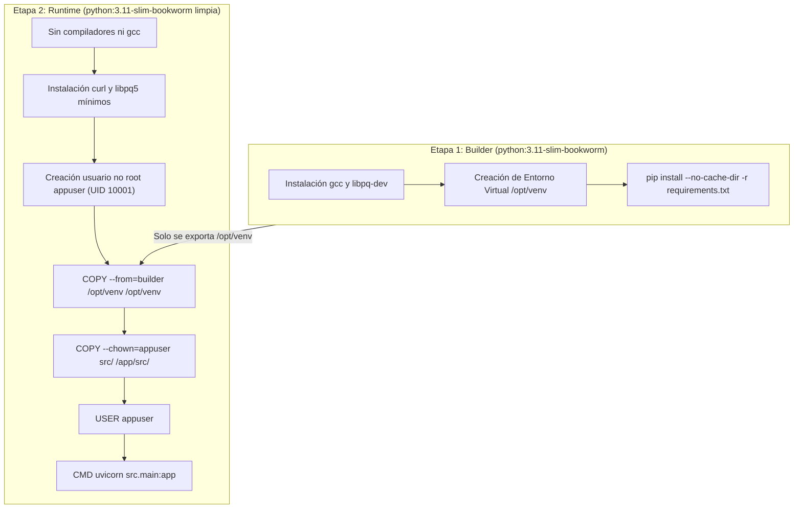

# Hito 2: Empaquetado Cloud Native, Entorno Local e Integración Continua (CI)

[](./hito2.md)
[](../README.md)
[](../compose.yaml)
[](../.github/workflows/ci.yml)
[-purple?style=flat-square&logo=github)](https://github.com/orgs/gag-04/packages)

> **Asignatura:** Cloud Computing: Fundamentos e Infraestructuras  
> **Máster Universitario en Ingeniería Informática** — Universidad de Granada  
> **Autor:** Germán Álvarez Gavilán ([@gag-04](https://github.com/gag-04))  
> **Proyecto:** AgroFactura Cloud 🌾📄  

---

## 📑 Índice de Contenidos

1. [Objetivo del Hito y Resumen Ejecutivo](#1-objetivo-del-hito-y-resumen-ejecutivo)
2. [Arquitectura de Microservicios y Contenerización](#2-arquitectura-de-microservicios-y-contenerización)
   - [2.1. Elección Fundamentada de Imágenes Base](#21-elección-fundamentada-de-imágenes-base)
   - [2.2. Construcción Multietapa (Multi-stage Builds)](#22-construcción-multietapa-multi-stage-builds)
   - [2.3. Principio de Mínimo Privilegio (Non-root user)](#23-principio-de-mínimo-privilegio-non-root-user)
   - [2.4. Optimización de Capas de Caché y Healthchecks](#24-optimización-de-capas-de-caché-y-healthchecks)
3. [Orquestación Local con Docker Compose (`compose.yaml`)](#3-orquestación-local-con-docker-compose-composeyaml)
   - [3.1. Definición del Clúster de 3 Contenedores](#31-definición-del-clúster-de-3-contenedores)
   - [3.2. Aislamiento de Redes Virtuales (Defensa en Profundidad)](#32-aislamiento-de-redes-virtuales-defensa-en-profundidad)
   - [3.3. Persistencia y Durabilidad de Datos](#33-persistencia-y-durabilidad-de-datos)
   - [3.4. Gestión de Configuración Segura (`.env.example`)](#34-gestión-de-configuración-segura-envexample)
4. [Flujo de Integración Continua (CI en GitHub Actions)](#4-flujo-de-integración-continua-ci-en-github-actions)
   - [4.1. Estructura y Disparadores del Workflow (`ci.yml`)](#41-estructura-y-disparadores-del-workflow-ciyml)
   - [4.2. Etapa de Linting y Validación de Dockerfiles (Hadolint + Ruff)](#42-etapa-de-linting-y-validación-de-dockerfiles-hadolint--ruff)
   - [4.3. Etapa de Pruebas Unitarias e Integración con PostgreSQL](#43-etapa-de-pruebas-unitarias-e-integración-con-postgresql)
   - [4.4. Publicación Automatizada en GitHub Container Registry (GHCR)](#44-publicación-automatizada-en-github-container-registry-ghcr)
5. [Guía de Verificación y Reproducción Local](#5-guía-de-verificación-y-reproducción-local)
   - [5.1. Despliegue del Clúster con Docker Compose](#51-despliegue-del-clúster-con-docker-compose)
   - [5.2. Verificación de Salud de los Servicios](#52-verificación-de-salud-de-los-servicios)
   - [5.3. Prueba de Emisión y Demostración de Persistencia](#53-prueba-de-emisión-y-demostración-de-persistencia)
   - [5.4. Uso del Panel Web Interactivo](#54-uso-del-panel-web-interactivo)
6. [Matriz de Trazabilidad de Requisitos del Hito 2](#6-matriz-de-trazabilidad-de-requisitos-del-hito-2)

---

## 1. Objetivo del Hito y Resumen Ejecutivo

El **Hito 2** consolida la transición de los contratos arquitectónicos y casos de uso formalizados en el Hito 1 hacia una infraestructura *Cloud-Native* funcional, inmutable y verificable.

Los principales objetivos completados son:
- **Empaquetado inmutable:** Contenerización multietapa para los microservicios `billing-core-service` y `document-rendering-service`.
- **Mínimo privilegio:** Creación explícita de usuarios de sistema no administradores (`USER appuser`, UID 10001) para mitigar riesgos de seguridad.
- **Orquestación reproducible:** Manifiesto `compose.yaml` (estándar Compose V2) que aprovisiona en un comando un clúster con 3 contenedores funcionales (`billing-core`, `document-rendering` y PostgreSQL 16 Alpine), redes virtuales aisladas y persistencia con volúmenes gestionados.
- **Integración Continua (CI):** Pipeline automatizado en GitHub Actions con validación estática de código (`ruff`), análisis de sintaxis de contenedores (`hadolint`), suite de 23 pruebas automatizadas con base de datos real y publicación automatizada en **GitHub Container Registry (GHCR)** con versionado semántico y hash SHA.

---

## 2. Arquitectura de Microservicios y Contenerización

### 2.1. Elección Fundamentada de Imágenes Base

Se ha seleccionado **`python:3.11-slim-bookworm`** como imagen base para ambos microservicios basándose en un estudio técnico comparativo:

| Criterio de Selección | `python:3.11` (Completa) | `python:3.11-alpine` | `python:3.11-slim-bookworm` (Elegida) |
| :--- | :--- | :--- | :--- |
| **Tamaño Base** | ~1.02 GB | ~55 MB | **~145 MB** |
| **Biblioteca C Estándar** | GNU C (`glibc`) | Musl libc (`musl`) | **GNU C (`glibc`)** |
| **Compatibilidad Ruedas C** | Ruedas precompiladas | Requiere compilación C | **Ruedas oficiales `manylinux`** |
| **Tiempos de Build** | ~45 s | > 7 min (compilando `psycopg2`/`pillow`) | **~35 s (aprovecha ruedas)** |
| **Superficie de Ataque / CVEs** | Alta (> 120 paquetes) | Mínima | **Muy reducida (< 30 paquetes)** |
| **Estabilidad en Renderizado** | Estable | Fallos en fuentes/Cairo | **Estable con tipografías vectoriales** |

Para el servicio de base de datos relacional se utiliza **`postgres:16-alpine`**, aprovechando que los binarios oficiales ya se encuentran compilados y optimizados para Alpine Linux, reduciendo la huella de memoria a menos de 80 MB.

---

### 2.2. Construcción Multietapa (Multi-stage Builds)

Cada `Dockerfile` implementa un patrón multietapa (*Multi-stage build*) con separación radical entre el entorno de construcción y el de ejecución:



**Beneficios obtenidos:**
1. **Reducción de tamaño:** Eliminación de más de 350 MB de herramientas de compilación (`gcc`, cabeceras de desarrollo, cachés de pip) en la imagen final.
2. **Seguridad reforzada:** Un hipotético atacante no dispone de herramientas de compilación en el contenedor para desplegar binarios maliciosos.

---

### 2.3. Principio de Mínimo Privilegio (Non-root user)

De acuerdo con las guías del NIST SP 800-190 (*Application Container Security Guide*), ningún contenedor de producción debe correr bajo `root`.  
Ambos Dockerfiles implementan explícitamente:

```dockerfile
# Creación de grupo y usuario del sistema no privilegiado
RUN groupadd -g 10001 appgroup && \
    useradd -u 10001 -g appgroup -s /sbin/nologin -d /app appuser

# Asignación de propiedad antes de conmutar
COPY --from=builder --chown=appuser:appgroup /opt/venv /opt/venv
COPY --chown=appuser:appgroup src/ /app/src/

# Ejecución forzada como usuario no administrador
USER appuser
```

---

### 2.4. Optimización de Capas de Caché y Healthchecks

- **Caché de Capas:** Copia del archivo `requirements.txt` en un paso independiente previo al código fuente. Las modificaciones en el código no invalidan las capas previas de instalación de librerías.
- **Sonda de Salud (*Healthcheck*):** Directiva nativa `HEALTHCHECK` configurada en cada Dockerfile:
  ```dockerfile
  HEALTHCHECK --interval=30s --timeout=5s --start-period=5s --retries=3 \
      CMD curl -f http://localhost:8000/api/v1/health || exit 1
  ```
- **Contexto Aislado (`.dockerignore`):** Exclusión estricta de repositorios Git, bases de datos locales (`*.db`), archivos de test (`tests/`), logs y cachés (`__pycache__`).

---

## 3. Orquestación Local con Docker Compose (`compose.yaml`)

### 3.1. Definición del Clúster de 3 Contenedores

El archivo `compose.yaml` define un clúster de 3 contenedores interconectados mediante Compose v2:

```
+---------------------------------------------------------------------------------+
|                         AGROFACTURA CLUSTER (compose.yaml)                      |
+---------------------------------------------------------------------------------+
|                                                                                 |
|   [ Cliente Navegador / Host ]                                                  |
|             |                                                                   |
|             | :8000 (HTTP / UI / REST)                                          |
|             v                                                                   |
|   +-------------------------------------------------------------------------+   |
|   | agrofactura-billing-core (billing-core-service)                          |   |
|   | - Motor Fiscal REAGP (12%) / IRPF (2%)                                  |   |
|   | - Secuenciador Correlativo ACID                                         |   |
|   | - Panel de Pruebas Web Interactivo (HTML5/Tailwind)                     |   |
|   +-------------------------------------------------------------------------+   |
|             |                                                     |             |
|             | M2M HTTP :8001                                      | SQL :5432   |
|             v                                                     v             |
|   +------------------------------------+   +--------------------------------+   |
|   | agrofactura-document-rendering     |   | agrofactura-db                 |   |
|   | - Plantilla Jinja2 HTML5 vector    |   | - PostgreSQL 16 Alpine         |   |
|   | - Compilador PDF Binario           |   | - Volumen: postgres_data       |   |
|   | - Conectores Google Drive / SMTP   |   | - Esquema: init-db.sql         |   |
|   +------------------------------------+   +--------------------------------+   |
|                                                                                 |
+---------------------------------------------------------------------------------+
```

---

### 3.2. Aislamiento de Redes Virtuales (Defensa en Profundidad)

El clúster declara **3 redes virtuales aisladas tipo puente**:
1. **`public-net`:** Expuesta al host. Conecta el navegador o cliente con la API y el panel web de `billing-core` (puerto 8000).
2. **`internal-net`:** Red interna para la comunicación M2M entre `billing-core` y `document-rendering`, validada mediante cabecera `X-Service-Token`.
3. **`backend-net`:** Red privada donde se alojan `billing-core` y `db`.

> **Garantía de Seguridad:** La base de datos PostgreSQL **no publica puertos hacia el host exterior** y es completamente inaccesible desde `document-rendering` o desde la red pública.

---

### 3.3. Persistencia y Durabilidad de Datos

- **Volumen Gestionado `postgres_data`:** Los datos de la base de datos se almacenan en un volumen persistente nombrado independiente del ciclo de vida de los contenedores. Al ejecutar `docker compose down` y luego `docker compose up -d`, la base de datos conserva todas las facturas y números correlativos.
- **Script de Inicialización (`scripts/init-db.sql`):** Montado en `/docker-entrypoint-initdb.d/init.sql` para inicializar automáticamente las tablas `users`, `customers`, `invoices`, `invoice_items` e `invoice_sequences` en el primer arranque.

---

### 3.4. Gestión de Configuración Segura (`.env.example`)

El proyecto incluye el archivo plantilla [`.env.example`](../.env.example) que documenta todas las variables de entorno sin comprometer secretos reales:
- Configuración de PostgreSQL (`POSTGRES_USER`, `POSTGRES_PASSWORD`, `POSTGRES_DB`).
- Tokens criptográficos (`JWT_SECRET`, `INTERNAL_M2M_TOKEN`).
- Modos simulados de intermediarios en la nube (`GDRIVE_MOCK_MODE=true`, `SMTP_MOCK_MODE=true`).

---

## 4. Flujo de Integración Continua (CI en GitHub Actions)

### 4.1. Estructura y Disparadores del Workflow (`ci.yml`)

El pipeline se encuentra configurado en [`.github/workflows/ci.yml`](../.github/workflows/ci.yml) y se dispara automáticamente ante:
- Eventos `push` a la rama `main`.
- Eventos `pull_request` dirigidos a `main`.
- Publicación de etiquetas de versión (`tags: ['v*']`).

---

### 4.2. Etapa de Linting y Validación de Dockerfiles (Hadolint + Ruff)

- **Linter de Código Python (`ruff`):** Verifica el cumplimiento de normas de estilo PEP8, ordenación de imports y detección de errores sintácticos en todo el repositorio.
- **Linter de Contenedores (`hadolint/hadolint-action@v3.1.0`):** Analiza exhaustivamente los dos `Dockerfile` asegurando que no haya sentencias inseguras ni violaciones de buenas prácticas.

---

### 4.3. Etapa de Pruebas Unitarias e Integración con PostgreSQL

- Aprovisiona un contenedor de servicio real de **PostgreSQL 16 Alpine** en GitHub Actions.
- Ejecuta las 23 pruebas automatizadas de la suite:
  - 9 tests unitarios del motor impositivo REAGP (+12% agrícola, +10.5% ganadero, -2% IRPF) y validador de NIF/CIF.
  - 8 tests de integración de API REST en `billing-core` (Auth JWT, CRUD clientes, rechazo HTTP 422, emisión atómica y streaming PDF).
  - 2 tests de compilación de plantillas Jinja2 y renderizado binario PDF (`%PDF-`).
  - 4 tests de integración del servicio de renderizado con autorización M2M.
- Genera un reporte de cobertura de código en terminal con `pytest-cov`.

---

### 4.4. Publicación Automatizada en GitHub Container Registry (GHCR)

- Emplea **Docker Buildx** con soporte para aceleración de caché de capas en GitHub Actions (`type=gha,mode=max`).
- Se autentica de forma segura contra `ghcr.io` usando `secrets.GITHUB_TOKEN` con permisos `packages: write`.
- Genera etiquetas multidimensionales:
  - `sha-<hash_corto>` para trazabilidad exacta por commit.
  - `latest` y `main` para la versión estable.
  - Etiquetas semánticas `vX.Y.Z` ante releases.
- **Control de Acceso en Pull Requests:** Si el evento es un `pull_request`, las imágenes se compilan para validar que la construcción no falla, pero se desactiva la publicación (`push: false`), impidiendo artefactos no autorizados en el registro.

---

## 5. Guía de Verificación y Reproducción Local

### 5.1. Despliegue del Clúster con Docker Compose

```bash
# 1. Clonar el repositorio y acceder a la rama de trabajo
git clone https://github.com/gag-04/Agrofactura-Cloud.git
cd Agrofactura-Cloud
git checkout feature/hito2-cloud-native-ci

# 2. Configurar el archivo de entorno desde la plantilla
cp .env.example .env

# 3. Construir y levantar todo el clúster en segundo plano
docker compose up -d --build
```

---

### 5.2. Verificación de Salud de los Servicios

```bash
# Comprobar el estado de los contenedores
docker compose ps

# Verificar sondeo de salud de billing-core
curl -i http://localhost:8000/api/v1/health

# Verificar sondeo de salud de document-rendering
curl -i http://localhost:8001/api/v1/health
```

---

### 5.3. Prueba de Emisión y Demostración de Persistencia

1. **Emitir Factura de Prueba:**
   ```bash
   curl -X POST http://localhost:8000/api/v1/invoices \
     -H "Content-Type: application/json" \
     -d '{
       "customer_id": 1,
       "issue_date": "2026-10-20",
       "tax_regime": "REAGP",
       "agricultural_compensation_pct": 12.0,
       "withholding_tax_pct": 2.0,
       "items": [
         {"description": "Aceituna Picual (kg)", "quantity": 10000.0, "unit_price": 1.00}
       ]
     }'
   ```
   *Respuesta esperada:* Código `201 Created` con número correlativo `AGR-2026-001`, Base: `10000.00 €`, Compensación REAGP: `1200.00 €`, Retención IRPF: `200.00 €`, Total: `11000.00 €`.

2. **Demostración de Persistencia:**
   ```bash
   # Detener y reiniciar los contenedores de la base de datos
   docker compose restart db

   # Consultar el libro de facturas para comprobar que los datos siguen intactos
   curl -i http://localhost:8000/api/v1/invoices
   ```
   *Resultado:* La factura `AGR-2026-001` permanece registrada de forma inalterable en el volumen `postgres_data`.

---

### 5.4. Uso del Panel Web Interactivo

Abre tu navegador en:
👉 **[http://localhost:8000](http://localhost:8000)**

- Podrás interactuar con la sesión preautenticada del agricultor.
- Introducir líneas de aceituna y portes con cálculo automático en vivo de impuestos agrarios.
- Pulsar **"Emitir y Sellar Factura Oficial"**.
- Hacer clic en **"👁️ Ver / Descargar PDF Oficial"** para comprobar la maquetación y tipografía del PDF generado.

---

## 6. Matriz de Trazabilidad de Requisitos del Hito 2

| Entregable / Requisito de la Rúbrica | Evidencia en el Repositorio | Estado de Verificación |
| :--- | :--- | :--- |
| **Dockerfiles de producción multietapa** | `services/billing-core/Dockerfile`<br>`services/document-rendering/Dockerfile` | ✅ Superado (Etapas `builder` y `runtime`, huella < 200 MB) |
| **Imágenes base minimalistas fundamentadas** | Memoria técnica (Sección 2.1) | ✅ Superado (`python:3.11-slim-bookworm` y `postgres:16-alpine`) |
| **Principio de mínimo privilegio (Non-root)** | Directiva `USER appuser` (UID 10001) en ambos Dockerfiles | ✅ Superado (Sin permisos root en ejecución) |
| **Optimización de caché de Docker** | Copia desacoplada de `requirements.txt` y `.dockerignore` | ✅ Superado (Re-build de código en < 2 s) |
| **Clúster Compose con mínimo 3 contenedores** | `compose.yaml` | ✅ Superado (`billing-core`, `document-rendering`, `db`) |
| **Redes virtuales aisladas** | `compose.yaml` (`public-net`, `internal-net`, `backend-net`) | ✅ Superado (Aislamiento estricto de PostgreSQL) |
| **Volúmenes persistentes gestionados** | `compose.yaml` (`postgres_data`) | ✅ Superado (Durabilidad demostrada tras reinicio) |
| **Variables de entorno seguras** | `.env.example` en la raíz | ✅ Superado (Sin credenciales reales comprometidas) |
| **CI en GitHub Actions (Push & PR)** | `.github/workflows/ci.yml` | ✅ Superado (Eventos en `main` y tags `v*`) |
| **Linter de código y de Dockerfiles** | `.github/workflows/ci.yml` (Job `lint`) | ✅ Superado (`ruff` y `hadolint/hadolint-action@v3.1.0`) |
| **Pruebas automáticas unitarias e integradas** | `.github/workflows/ci.yml` (Job `test`) | ✅ Superado (23 pruebas automáticas con PostgreSQL efímero) |
| **Publicación automatizada en GHCR** | `.github/workflows/ci.yml` (Job `build-and-publish`) | ✅ Superado (`ghcr.io` con tags SHA, semver y latest) |
